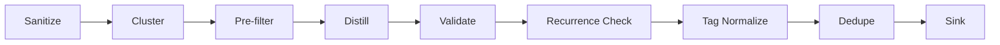

# Pattern Discovery

Pattern Discovery clusters free-text evidence into recurring themes and distills them into actionable **learning artifacts**. It works with any text source — annotation notes, bug reports, user feedback, support tickets — and provides a full pipeline from raw text to validated insights.

## What You'll Learn

<div class="rule-grid" markdown="0">
<div class="rule-card">
<span class="rule-card__number">1</span>
<p class="rule-card__title">Evidence Clustering</p>
<p class="rule-card__desc">Cluster any text into semantic themes using LLM, BERTopic, or hybrid methods.</p>
</div>
<div class="rule-card">
<span class="rule-card__number">2</span>
<p class="rule-card__title">Evidence Pipeline</p>
<p class="rule-card__desc">Full pipeline: sanitize &rarr; cluster &rarr; distill &rarr; validate &rarr; dedupe &rarr; sink.</p>
</div>
<div class="rule-card">
<span class="rule-card__number">3</span>
<p class="rule-card__title">Learning Artifacts</p>
<p class="rule-card__desc">Distill clusters into titled insights with recommended actions and confidence scores.</p>
</div>
<div class="rule-card">
<span class="rule-card__number">4</span>
<p class="rule-card__title">Quality & Safety</p>
<p class="rule-card__desc">Validation gates, PII filtering, recurrence checks, and deduplication strategies.</p>
</div>
</div>

## Quick Start

### Clustering Only

Cluster a list of `EvidenceItem` objects into semantic groups:

```python
from axion.caliber import PatternDiscovery, EvidenceItem, ClusteringMethod

evidence = [
    EvidenceItem(id='bug_1', text='Checkout button unresponsive on mobile Safari'),
    EvidenceItem(id='bug_2', text='Payment form does not submit on iPhone'),
    EvidenceItem(id='bug_3', text='Cart total shows wrong currency symbol'),
    EvidenceItem(id='bug_4', text='Currency formatting broken for EUR prices'),
]

discovery = PatternDiscovery(model_name='gpt-6-luna', min_category_size=2)
result = await discovery.discover_from_evidence(evidence)

for pattern in result.patterns:
    print(f'[{pattern.category}] ({pattern.count} items): {pattern.record_ids}')
```

### Full Pipeline

Run the complete pipeline — clustering, distillation into learning artifacts, validation, and persistence:

```python
from axion.caliber import EvidencePipeline, InMemorySink, MetadataConfig

sink = InMemorySink()

pipeline = EvidencePipeline(
    model_name='gpt-6-luna',
    recurrence_threshold=2,
    min_category_size=2,
    domain_context='E-commerce platform bug triage',
    sink=sink,
)

result = await pipeline.run(evidence)

for learning in result.learnings:
    print(f'{learning.title} (confidence={learning.confidence})')
    for action in learning.recommended_actions:
        print(f'  - {action}')
```

## Core Concepts

### EvidenceItem

The universal input type. Any text source with an ID, the text itself, optional metadata, and an optional source reference for provenance tracking:

```python
EvidenceItem(
    id='ticket_42',
    text='Search returns no results for valid product names',
    metadata={'severity': 'high', 'platform': 'web'},
    source_ref='jira_PROJ-42',  # for recurrence checking
)
```

### Clustering Methods

| Method | How it works | Best for |
|--------|-------------|----------|
| `ClusteringMethod.LLM` | LLM reads all evidence and outputs semantic clusters | Small-medium datasets, best label quality |
| `ClusteringMethod.BERTOPIC` | BERTopic statistical topic modeling, no LLM calls | Large datasets, cost-sensitive, 5+ documents |
| `ClusteringMethod.HYBRID` | BERTopic clustering + LLM label refinement | Large datasets where you want readable labels |

```python
# LLM-only (default)
result = await discovery.discover_from_evidence(evidence, method=ClusteringMethod.LLM)

# BERTopic (no LLM cost)
result = await discovery.discover_from_evidence(evidence, method=ClusteringMethod.BERTOPIC)

# Hybrid: BERTopic clusters + LLM-refined labels
result = await discovery.discover_from_evidence(evidence, method=ClusteringMethod.HYBRID)
```

### Learning Artifacts

The pipeline distills each cluster into a `LearningArtifact` — a structured insight ready for consumption:

```python
LearningArtifact(
    title='Mobile Checkout Failures on iOS',
    content='Multiple reports of checkout and payment flows...',
    tags=['ios', 'checkout', 'mobile'],
    confidence=0.9,
    supporting_item_ids=['bug_1', 'bug_2', 'feedback_1'],
    recommended_actions=[
        'Investigate touch event handling in mobile Safari',
        'Add fallback submit mechanism for iOS WebKit',
    ],
    counterexamples=['bug_3'],       # IDs that look similar but differ
    scope='iOS mobile checkout flow',
    when_not_to_apply='Desktop browsers or Android devices',
)
```

## Evidence Pipeline

The `EvidencePipeline` orchestrates the full workflow:



### Pipeline Stages

| Stage | What it does | Configurable via |
|-------|-------------|-----------------|
| **Sanitize** | Optional async text cleaning | `sanitizer=` (implements `Sanitizer` protocol) |
| **Cluster** | Groups evidence into themes | `method=`, `clusterer=` (implements `EvidenceClusterer`) |
| **Pre-filter** | Drops clusters spanning fewer than `recurrence_threshold` distinct recurrence keys | `recurrence_threshold=`, `recurrence_key_fn=` |
| **Distill** | LLM converts each cluster into a learning artifact; sees up to 5 examples spread across recurrence keys, each with its id | `domain_context=`, `max_concurrent_distillations=` |
| **Validate** | Repairs hallucinated IDs, enforces quality gates | Automatic |
| **Recurrence** | Ensures learnings span multiple unique sources | `recurrence_threshold=` |
| **Tag normalize** | Lowercase, deduplicate, cap at 10 tags | Automatic |
| **Dedupe** | Removes near-duplicate learnings | `deduper=` (implements `Deduper`) |
| **Sink** | Persists artifacts with provenance metadata | `sink=` (implements `ArtifactSink`) |

### Configuration

```python
pipeline = EvidencePipeline(
    # LLM settings
    model_name='gpt-6-luna',
    llm_provider='openai',

    # Clustering
    method=ClusteringMethod.LLM,
    min_category_size=2,
    max_notes=200,

    # Distillation
    domain_context='Customer support ticket analysis',
    max_concurrent_distillations=5,

    # Quality gates
    recurrence_threshold=2,  # need 2+ unique sources per learning

    # Metadata
    metadata_config=MetadataConfig(
        include_in_clustering=True,
        include_in_distillation=True,
        allowed_keys={'severity', 'platform', 'category'},
    ),

    # Plugins
    sink=InMemorySink(),
    deduper=InMemoryDeduper(),
)
```

### Pipeline Result

```python
result = await pipeline.run(evidence)

result.clustering_result   # PatternDiscoveryResult — the raw clusters
result.learnings           # list[LearningArtifact] — distilled insights
result.filtered_count      # clusters dropped by pre-filter
result.deduplicated_count  # learnings removed by deduper
result.validation_repairs  # count of hallucinated-ID repairs
result.sink_ids            # IDs returned by the sink after persistence
result.input_count         # items handed to run(), before sampling
result.sampled_out         # items dropped to fit max_items
result.duplicates_dropped  # exact repeats collapsed from a sequence input
result.coverage            # accounting: where every item ended up (below)
result.records             # list[LearningRecord] — same order as learnings, with
                           # provenance, score, cluster, and sink outcome
result.failed_clusters     # list[FailedCluster] — clusters whose distillation raised
```

### Learning Records and Provenance

Every learning gets a `Provenance`, sink or no sink, exposed on `result.records`.
Beyond the original fields it carries:

| Field | Meaning |
|-------|---------|
| `distinct_keys` | Sorted unique recurrence keys among the cited items |
| `distinct_key_count` | How many independent sources back the learning |
| `cited_support_count` | Items the writer cited (same as `supporting_count`) |
| `cluster_size` | Items in the cluster it was distilled from. The writer saw a sample of these, so this is cluster-level evidence, not support for this specific learning |

### Ranking

Learnings are ordered by LLM confidence unless you pass `score_fn(learning, provenance, supporting_items) -> float`.
Two scorers ship: `score_by_confidence` (the default) and `score_by_distinct_keys` (independent recurrence first, confidence as tie-break; one more distinct key always outranks any confidence).
The scorer receives the same complete `Provenance` the sink does, so it may read any field, including `source_ref`, `total_analyzed`, and `metadata`.
A custom scorer can read anything on the items, for example a weight carried in metadata:

```python
from axion.caliber import score_by_distinct_keys

pipeline = EvidencePipeline(
    ...,
    recurrence_key_fn=lambda item: item.source_ref or item.id,
    score_fn=score_by_distinct_keys,
)

# or weight by metadata, summed once per distinct source
def weighted(learning, provenance, items):
    seen, total = set(), 0.0
    for item in items:
        if item.source_ref not in seen:
            seen.add(item.source_ref)
            total += item.metadata.get('weight', 0)
    return total
```

With a `score_fn` the pipeline validates every candidate a cluster produced and then keeps the best-scored `max_learnings_per_cluster`, so the score drives selection as well as order.
Without one, candidates are truncated by confidence before validation, as before.
Ordering always happens before deduplication, so the best-scored twin survives.
`LearningRecord.score` records what each learning was ranked by.

### Failure Policy

Defaults are unchanged: a cluster whose distillation raises is logged and skipped, and a sink write that raises propagates after any earlier writes.
Both are now visible and configurable:

| Parameter | Default | Effect |
|-----------|---------|--------|
| `result.failed_clusters` | always | Category, error, and item count for every cluster that failed to distill |
| `fail_on_all_errors=True` | `False` | Raise `RuntimeError` when every surviving cluster failed, instead of returning an empty result |
| `sink_on_error='continue'` | `'raise'` | Record the error on `LearningRecord.sink_error`, keep writing the rest. `sink_ids` lists successes only |

### Coverage Accounting

Every item handed to `run()` ends up in exactly one bucket, so a model that quietly drops items is distinguishable from filters you configured.
`result.coverage` (and `PatternDiscoveryResult.metadata['coverage']` for standalone clustering) carries:

| Bucket | Meaning |
|--------|---------|
| `sampled_out` | Dropped to fit `max_items` before clustering |
| `ineligible` | Empty text, never submitted |
| `assigned` | Placed in a surviving pattern |
| `uncategorized` | The model said it fits no pattern |
| `filtered_small_cluster` | Placed in a pattern smaller than `min_category_size` |
| `filtered_below_threshold` | Placed in a cluster the pipeline pre-filter dropped |
| `omitted_by_model` | Submitted, but returned in neither a pattern nor `uncategorized` (`omitted_ids` lists them) |
| `ratio` | Model coverage: share of *submitted* items the model placed anywhere. Filters never count against it |

The buckets are mutually exclusive and sum to `input_count` less `sampled_out` and `duplicates_dropped`; an item whose cluster the pipeline pre-filter dropped is counted in `filtered_below_threshold`, not `assigned`.
Every key is present on every result, including results that never reached a model (blank-only input, too few documents) and results from a custom `clusterer` that reports no coverage of its own, in which case the buckets are derived from what it returned.
Set `min_coverage=0.9` to log a warning when `ratio` falls below it (the result gets `coverage['below_min'] = True`); add `raise_on_low_coverage=True` to raise `LowCoverageError` instead.
`clustering_excerpt_chars=` caps the text per item sent to the clustering call; the default sends full text.

### Grouped Evidence

When several items hang off one parent (chunks of a conversation, findings on a ticket), set `recurrence_key_fn` to the parent so recurrence counts parents, not items:

```python
pipeline = EvidencePipeline(
    ...,
    recurrence_threshold=2,
    recurrence_key_fn=lambda item: item.source_ref or item.id,
)
```

With a key in place the pipeline pre-filters clusters by distinct keys, spreads distillation examples round-robin across keys, and passes `distinct_source_count` to the distiller so its confidence anchors to independent sources.
Ten items from one parent are one observation.

## Metadata Handling

### MetadataConfig

Control how metadata flows through the pipeline:

```python
from axion.caliber import MetadataConfig

config = MetadataConfig(
    include_in_clustering=True,      # attach metadata to clustering prompts
    include_in_distillation=True,    # attach metadata to distillation prompts
    allowed_keys={'severity', 'platform'},  # only these keys pass through
    denied_keys=set(),               # explicit denylist (PII defaults apply)
)
```

### PII Safety

By default, metadata keys matching common PII patterns are excluded:

> `email`, `phone`, `name`, `address`, `ssn`, `password`, `token`, `credit_card`

These are filtered before any data reaches an LLM. You can customize the denylist via `MetadataConfig.denied_keys`.

### Metadata in Clusters

When `include_in_clustering=True`, each evidence note sent to the LLM includes a compact header:

```
[meta: severity=high, platform=ios] Checkout button unresponsive on mobile Safari
```

During distillation, cluster-level metadata is aggregated into frequency distributions so the LLM sees patterns like "severity: high (3), medium (1)".

## Plugins

### Sinks (Output Storage)

=== ":material-memory: InMemorySink"

    Dict-based storage, ideal for testing and notebooks:

    ```python
    from axion.caliber import InMemorySink

    sink = InMemorySink()
    result = await pipeline.run(evidence)

    for sid, entry in sink.artifacts.items():
        print(entry['artifact'].title, entry['provenance'].timestamp)
    ```

=== ":material-file-document: JsonlSink"

    Appends each artifact as a JSON line to a file:

    ```python
    from axion.caliber import JsonlSink

    sink = JsonlSink(path='learnings.jsonl')
    result = await pipeline.run(evidence)
    # Each learning is appended as one JSON line
    ```

=== ":material-puzzle: Custom Sink"

    Implement the `ArtifactSink` protocol:

    ```python
    from axion.caliber import ArtifactSink, LearningArtifact, Provenance

    class DatabaseSink:
        async def write(
            self,
            artifact: LearningArtifact,
            provenance: Provenance,
        ) -> str:
            # persist to your database
            return record_id
    ```

### Dedupers

=== ":material-text-search: InMemoryDeduper"

    Case-insensitive title matching — lightweight, no external dependencies:

    ```python
    from axion.caliber import InMemoryDeduper

    deduper = InMemoryDeduper()
    ```

=== ":material-vector-triangle: EmbeddingDeduper"

    Cosine similarity on OpenAI embeddings (threshold defaults to 0.85):

    ```python
    from axion.caliber import EmbeddingDeduper

    deduper = EmbeddingDeduper(threshold=0.85)  # requires axion[embeddings]
    ```

## Validation & Quality Gates

The pipeline automatically validates every learning artifact:

### Cluster Output Repair

Raw clustering output is validated before anything trusts it: ids that were never submitted are dropped, repeats within a pattern are collapsed, and `uncategorized` loses unknown ids and ids that are also assigned.
Counts are in `PatternDiscoveryResult.metadata['cluster_repairs']`.
Items may appear in more than one pattern by default; pass `disjoint_clusters=True` to keep only the first assignment.

### Hallucinated ID Repair

If the LLM references item IDs that don't exist in the cluster, they are silently removed. Repeated supporting ids are collapsed, and an id cannot be both support and counterexample for the same learning. If **all** supporting IDs are invalid, the learning is dropped entirely.

### Input Integrity

A sequence input may repeat an item only if the repeats are identical (they are collapsed and counted in `duplicates_dropped`). Two different items sharing an id raise `ValueError`.

### Confidence Demotion

Learnings with `confidence >= 0.7` but **no recommended actions** are demoted to `confidence = 0.69` — the reasoning being that a high-confidence insight should be actionable.

### Recurrence Checking

A learning must be backed by evidence from multiple unique sources (controlled by `recurrence_threshold`). The source of an item is whatever `recurrence_key_fn` returns; the default is the item id, so pass a key (for example `lambda item: item.source_ref or item.id`) to make two chunks from the same conversation count as one source.

```python
# Standalone usage
from axion.caliber.pattern_discovery._utils import validate_learning

repaired, repair_count = validate_learning(raw_learning, cluster_item_ids)
```

## Legacy API

The original `discover()` method still works for annotation-based workflows:

```python
from axion.caliber import PatternDiscovery, AnnotatedItem

annotations = {
    'rec_1': AnnotatedItem(record_id='rec_1', score=0, notes='Missing context'),
    'rec_2': AnnotatedItem(record_id='rec_2', score=0, notes='Too verbose'),
}

discovery = PatternDiscovery(model_name='gpt-6-luna')
result = await discovery.discover(annotations, method=ClusteringMethod.LLM)
```

This is equivalent to converting annotations to `EvidenceItem` objects and calling `discover_from_evidence()`. The conversion happens automatically via the compatibility layer.

## Using with Evaluation Issues

The `InsightExtractor` bridges evaluation issues with this pipeline. It converts `ExtractedIssue` objects (from the [Issue Extractor](../../guides/issue-extraction.md)) into `EvidenceItem` objects and runs them through `EvidencePipeline` to discover cross-metric patterns:

```python
from axion.reporting import IssueExtractor, InsightExtractor

issues = IssueExtractor().extract_from_evaluation(results)
insights = await InsightExtractor(model_name='gpt-6-luna').analyze(issues)

for pattern in insights.patterns:
    if pattern.is_cross_metric:
        print(f"{pattern.category}: {', '.join(pattern.metrics_involved)}")
```

See the [Cross-Metric Insight Extraction Guide](../../guides/insight-extraction.md) for full details.

## API Summary

| API | Input | Output | Use when |
|-----|-------|--------|----------|
| `PatternDiscovery.discover()` | `Dict[str, AnnotatedItem]` | `PatternDiscoveryResult` | You have annotation notes from human evaluators |
| `PatternDiscovery.discover_from_evidence()` | `Sequence[EvidenceItem]` or `Dict` | `PatternDiscoveryResult` | Clustering only, from any text source |
| `EvidencePipeline.run()` | `Sequence[EvidenceItem]` or `Dict` | `PipelineResult` | Full pipeline: cluster + distill + validate + dedupe + sink |
| `InsightExtractor.analyze()` | `IssueExtractionResult` | `InsightResult` | Cross-metric pattern discovery from evaluation issues |

---

<div class="ref-nav" markdown="1">

[Caliber API Reference :octicons-arrow-right-24:](../../reference/caliber.md){ .md-button .md-button--primary }
[CaliberHQ Guide :octicons-arrow-right-24:](../../guides/caliberhq.md){ .md-button }
[Example Selector :octicons-arrow-right-24:](example-selector.md){ .md-button }

</div>
